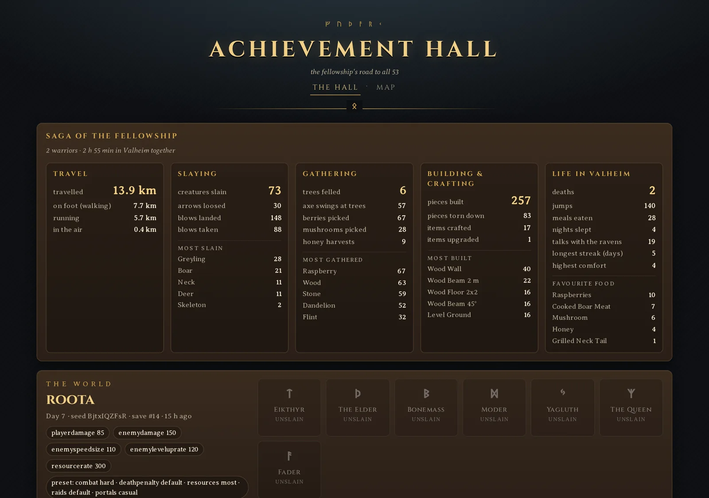
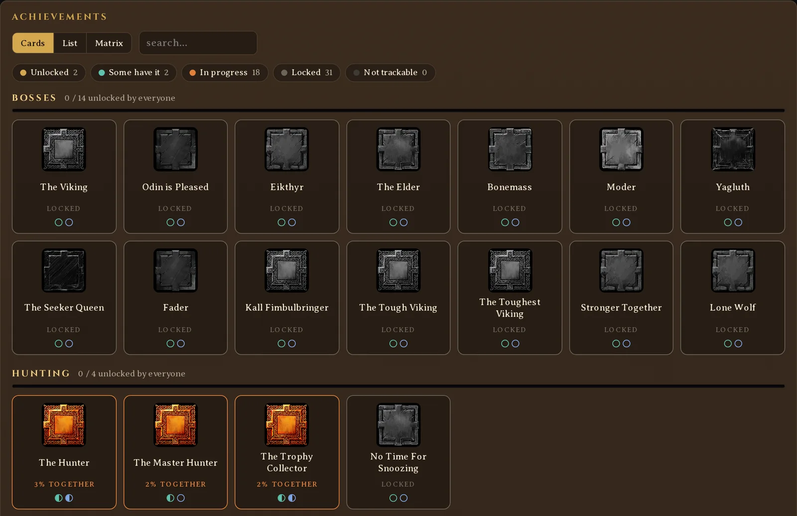
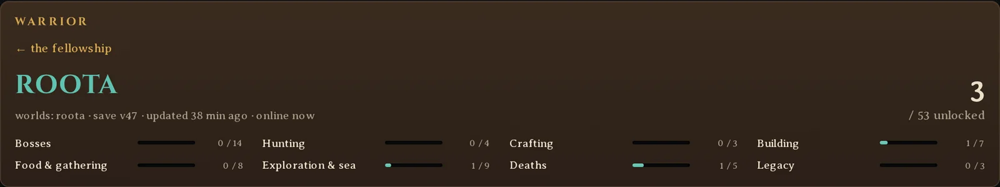

# valheim-tracker

A shared dashboard for a group playing Valheim 1.0 together: how far the fellowship is on the road to all 53 achievements, what is still missing in each biome, the stats of your saga and a map of the world you have explored. Read-only, no game mods: it reads the character files the game already writes.



## What you get

**The Hall** (the dashboard's main page)

- **Saga of the Fellowship**: travel, slaying, gathering, building and life in Valheim, added up for the group, with the most slain creatures, most gathered resources and favourite foods.
- **The World**: day, seed, world modifiers and which bosses have fallen.
- **The Fellowship**: everyone who syncs, which world they are in, and one progress bar for the whole group (online or resting).
- **The Road**: per biome, what is still to slay, kill, craft, build, cook, eat or catch, with one dot per warrior so you can see who still needs what.
- **Achievements**: all 53, grouped by category (cards, list or matrix), with the group's shared progress.
- **Warrior pages** (`#player/<name>`): one character's chronicle, categories and everything they still miss.

<table>
<tr>
<td width="50%"><br><sub><b>The Road</b>: what is still missing in each biome</sub></td>
<td width="50%"><br><sub><b>Achievements</b> by category, progress shared by the fellowship</sub></td>
</tr>
</table>



**The Map** (`#map`)

The world drawn from its seed with the game's own biome rules, coloured where any of you has been, with boss altars, traders, dungeons, beds, deaths and map pins. Undiscovered land and places stay hidden unless you tick "reveal" (shown revealed here).


**Tracker Sync** (desktop app for Windows, macOS and Linux)

Enter the server address and token once; it finds the characters folder, uploads every character that changes and shows the status of each one. Untick characters you don't want to share.


## How it works

```
player PC                                     server (docker compose)
  Valheim writes <name>.fch                     valheim-server ──── world save (read-only) ───┐
  Tracker Sync / fchsync.sh ── raw .fch ─────▶  tracker (server.py): parses and analyses      ├──▶ dashboard :8088
                               + shared token    every upload, reads the world folder ─────────┘
```

- The clients upload the **raw** character file when it changes, plus a heartbeat. They never parse a save and never write to the game folder.
- `server.py` (Python, standard library only) does all the parsing: achievements, stats, the explored map. It reads the world folder read-only for the seed, bosses and locations.
- A character that stops reporting is shown as "resting"; its progress stays.

## Setup

### Server

    cp .env.example .env            # set SERVER_PASS, TRACKER_TOKEN, WORLD_NAME
    # put your world folder into config/worlds_local/<WORLD_NAME>/
    docker compose up -d            # dashboard: http://localhost:8088

`docker-compose.yaml` runs the dedicated server ([community-valheim-tools/valheim-server-docker](https://github.com/community-valheim-tools/valheim-server-docker)) and the tracker image `ghcr.io/yggdrion/valheim-tracker` (`TRACKER_TAG` picks a release, default `latest`). Uploads are plain HTTP with a shared token: put a reverse proxy with TLS in front before exposing it.

### Players

**Tracker Sync**: download the installer for your system from the [latest release](https://github.com/yggdrion/valheim-tracker/releases/latest), start it, enter the server address and the token. The builds are not signed: Windows SmartScreen and macOS Gatekeeper warn the first time (macOS: right-click > Open).

**Headless** (Linux, macOS, Steam Deck, servers): `fchsync.sh` needs bash and curl.

    TRACKER_TOKEN=<token> ./fchsync.sh -s http://host:8088                       # watch and sync
    ./fchsync.sh -d "<characters folder>" -s http://host:8088 -t <token> -1      # one folder, sync once

Without `-d` it looks in the usual places (local saves, Steam Cloud `userdata/*/892970/remote/characters`, the Proton prefix). Env alternatives: `TRACKER_SERVER`, `TRACKER_TOKEN`, `FCH_DIR`.

**Windows script** (until Tracker Sync has been tried there): copy `fchsync.env.example` to `fchsync.env`, set server and token, double-click `fchsync.bat` (or `.\fchsync.ps1 -Server http://host:8088 -Token <token>`).

Character files live on each player's PC (`%USERPROFILE%\AppData\LocalLow\IronGate\Valheim\characters_local`, or `Steam\userdata\<id>\892970\remote\characters` with Steam Cloud); the server only sees what the clients upload.

## Releases

Automatic on every push to `main` (`.github/workflows/build.yml`): the server image and Tracker Sync are built together. When the commits since the last release include `feat:` (minor) or `fix:` / `chore:` (patch), semantic-release tags `vX.Y.Z`, publishes the image as `:X.Y.Z` and `:latest`, creates the GitHub release with the installers and updates `CHANGELOG.md`. `docs:` / `ci:` commits only build.

## Development

    TRACKER_TOKEN=dev WORLD_DIR=<world folder> python server.py --port 8088      # dashboard without docker
    python analyze.py Some.fch                                                    # quick check of one character
    cd client && bun install && bun run dev                                       # Tracker Sync (needs Rust)

Game data, regenerate after a Valheim patch (read-only on the game install):

- Achievement tables: `vendor/achi_hunter.py` from [Melichor/ValheimSaveParser](https://github.com/Melichor/ValheimSaveParser); update with `python scripts/update_melichor.py` (see `.claude/skills/update-melichor/SKILL.md`) and `python scripts/update_achievements.py` for the Steam list.
- `scripts/extract_stat_names.py` → `stat_names.json` (needs dnfile), `scripts/extract_names.py` → `names.json` (needs UnityPy), `scripts/extract_location_names.py <world folder>` → `location_names.json`.
- The biome generator in `worldgen.js` ports the game's `WorldGenerator`; it was checked against a real world's 12,176 placed locations (every boss altar, trader and dungeon in its own biome).
