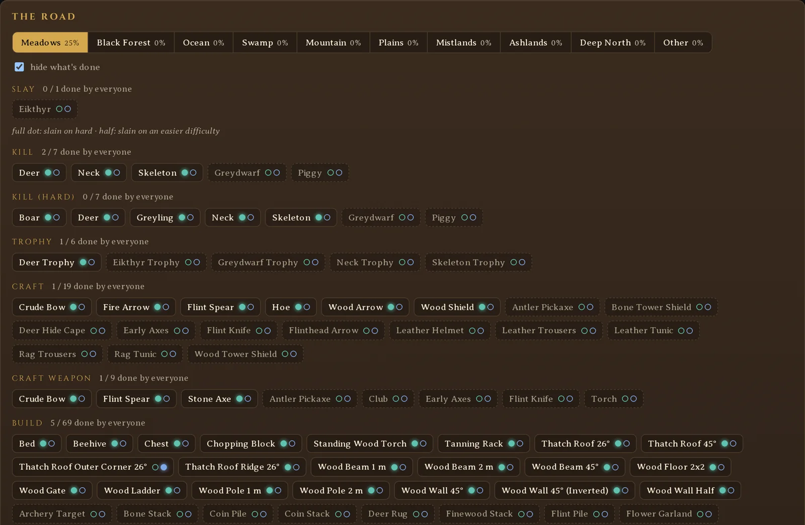
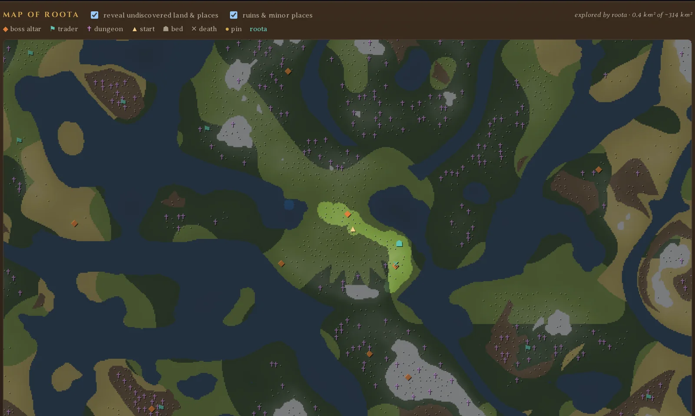
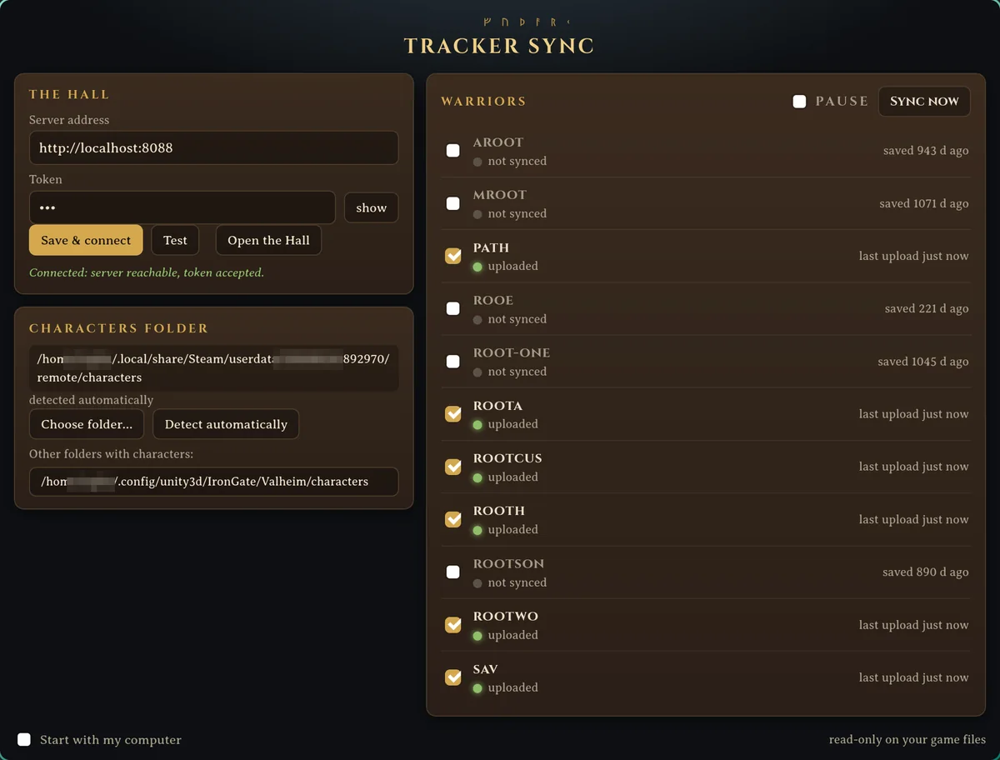

# valheim-tracker

A shared dashboard for a group playing Valheim 1.0 together: how far the fellowship is on the road to all 53 achievements, what is still missing in each biome, the stats of your saga and a map of the world you have explored. Read-only, no game mods: it reads the character files the game already writes.


## What you get

**The Hall** (the dashboard's main page)

- **Saga of the Fellowship**: travel, slaying, gathering, building and life in Valheim, added up for the group, with the most slain creatures, most gathered resources and favourite foods.
- **The World**: day, seed, world modifiers and which bosses have fallen.
- **The Fellowship**: everyone who syncs, which world they are in, and one progress bar for the whole group (online or resting).
- **The Road**: per biome, what is still to slay, kill, craft, build, cook, eat or catch, with one dot per warrior so you can see who still needs what.
- **Achievements**: all 53, grouped by category (cards, list or matrix), with the group's shared progress.
- **Warrior pages** (`#player/<name>`): one character's chronicle, categories and everything they still miss.

<table>
<tr>
<td width="50%"><br><sub><b>The Road</b>: what is still missing in each biome</sub></td>
<td width="50%"><br><sub><b>Achievements</b> by category, progress shared by the fellowship</sub></td>
</tr>
</table>


**The Map** (`#map`)

The world drawn from its seed with the game's own biome rules, coloured where any of you has been, with boss altars, traders, dungeons, beds, deaths and map pins. Undiscovered land and places stay hidden unless you tick "reveal" (shown revealed here).



**The Valheim Tracker app** (desktop app for Windows, macOS and Linux; called Tracker Sync before 1.5)

Enter the server address and token once; it finds the characters folder, uploads every character that changes and shows the status of each one. Untick characters you don't want to share.



## How it works

```
player PC                                     server (docker compose)
  Valheim writes <name>.fch                     valheim-server ──── world save (read-only) ───┐
  tracker app ───────── raw .fch ─────▶  tracker (tracker-server): parses and analyses ├──▶ dashboard :8088
                               + shared token    every upload, reads the world folder ─────────┘
```

- The app uploads the **raw** character file when it changes, plus a heartbeat. It never parses a save and never writes to the game folder.
- One Rust core (`client/core`) does all the parsing: achievements, stats, the explored map. It reads the world folder read-only for the seed, bosses and locations. The server (`tracker-server`, in the Docker image) and Tracker Sync run the same code: the app serves the Hall itself on `127.0.0.1` for local play, so one player can use it without any server.
- A character that stops reporting is shown as "resting"; its progress stays.

## Setup

### Server

    cp .env.example .env            # set SERVER_PASS, TRACKER_TOKEN, WORLD_NAME
    # put your world folder into config/worlds_local/<WORLD_NAME>/
    docker compose up -d            # dashboard: http://localhost:8088

`docker-compose.yaml` runs the dedicated server ([community-valheim-tools/valheim-server-docker](https://github.com/community-valheim-tools/valheim-server-docker)) and the tracker image `ghcr.io/yggdrion/valheim-tracker` (`TRACKER_TAG` picks a release, default `latest`). Uploads are plain HTTP with a shared token: put a reverse proxy with TLS in front before exposing it.

### Players

**The app**: download the installer for your system from the [latest release](https://github.com/yggdrion/valheim-tracker/releases/latest), start it, enter the server address and the token. The builds are not signed: Windows SmartScreen and macOS Gatekeeper warn the first time (macOS: right-click > Open). Playing solo? The app is all you need: leave the server empty and the Hall shows your own characters and the newest 1.0 world next to them (pick another world in Settings). With a server set, a **Local / Group** switch appears: Local is your own characters, Group is the server's Hall. Upgrading from Tracker Sync (before 1.5) on Windows: the update installs *Valheim Tracker* as a new app next to the old one; uninstall *Valheim Tracker Sync* once and tick "Start with my computer" again in the new app (settings carry over). The app updates itself: it checks the latest release on start and every 6 hours and offers an *Update & restart* button (updates are signed with a minisign key, `TAURI_SIGNING_PRIVATE_KEY` repo secret; the public key is in `client/src-tauri/tauri.conf.json`).

Character files live on each player's PC (`%USERPROFILE%\AppData\LocalLow\IronGate\Valheim\characters_local`, or `Steam\userdata\<id>\892970\remote\characters` with Steam Cloud); the server only sees what the app uploads.

## Releases

Automatic on every push to `main` (`.github/workflows/build.yml`): the server image and the app are built together. When the commits since the last release include `feat:` (minor) or `fix:` / `chore:` (patch), semantic-release tags `vX.Y.Z`, publishes the image as `:X.Y.Z` and `:latest`, creates the GitHub release with the installers and updates `CHANGELOG.md`. `docs:` / `ci:` commits only build.

## Development

    cd client && cargo run -p tracker-server -- --port 8088      # dashboard without docker (env TRACKER_TOKEN=dev WORLD_DIR=<world folder>)
    cd client && cargo run -p tracker-server -- check Some.fch   # quick check of one character
    cd client && cargo test --workspace                          # tests (CI runs this on Linux)
    cd client && bun install && bun run dev                      # the app (needs Rust)

The parity tests compare the Rust core with numbers dumped from the former Python runtime and skip when `testdata/golden/` is absent. Goldens can only be dumped from a commit before the Python runtime was removed (the commit before "Python runtime replaced by the Rust core"); `testdata/` is never committed.

Game data, regenerate after a Valheim patch (read-only on the game install):

- `scripts/extract_game_data.py <world folder>` → `gamedata.json`: the achievement sections (what each lists, which save counter and difficulty set it reads) and the earliest biome of every entry for The Road, built from the game's own files by the game's own rules (needs UnityPy, bun or node and a built `tracker-server`: `cd client && cargo build --release -p tracker-server`; set `TRACKER_BIN` to use another binary). Biome links the game hides in attack scripts are in `curated/biome_links.json`; reviewed exceptions in `curated/biome_overrides.json`. It prints any entry left without a biome.
- `scripts/extract_achievements.py` + `scripts/build_stat_map.py` → `stat_map.json` (the counter achievements), `scripts/update_achievements.py` → `achievements.json` (the Steam list).
- The save parser (`client/core/src/fch.rs`) follows the game's `PlayerProfile.SavePlayerToDisk`; a layout change shows up as a clear upload error.
- `scripts/extract_stat_names.py` → `stat_names.json` (needs dnfile), `scripts/extract_names.py` → `names.json` (needs UnityPy), `scripts/extract_location_names.py <world folder>` → `location_names.json` (these two scripts also need the built `tracker-server`).
- The biome generator in `worldgen.js` ports the game's `WorldGenerator`; it was checked against a real world's 12,176 placed locations (every boss altar, trader and dungeon in its own biome).
